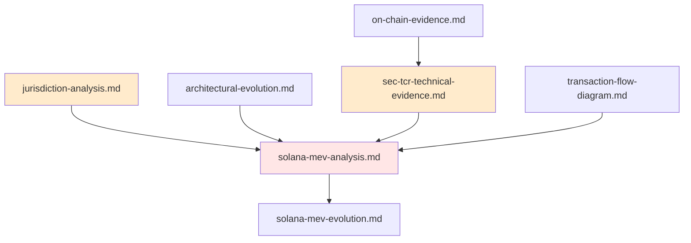

# If you're new round these parts...

These are research notes written between January 27 and February 15, 2025, while *Aguilar v. Baton Corporation Ltd. d/b/a Pump.Fun* was being filed in the Southern District of New York (No. 1:25-cv-00880). The author had worked on the Pump.fun team in 2024. Five commits on January 30, 2025, the day the first complaint was filed, came from a Burwick Law account. They are the interview questions in [storytime.md](storytime.md).

## What the case did with these ideas

| Idea in this repo | Where it shows up in the case | What happened to it |
|---|---|---|
| 32 New York-based Solana Labs engineers wrote 8,106 commits, 39.4% of contributions ([jurisdiction-analysis.md](jurisdiction-analysis.md)) | Consolidated amended complaint ¶53 (Dkt. 34, July 23, 2025): "at least 32" engineers, "over 8,100" commits, "39%" | Kept without the numbers in the second amended complaint ¶87 (Dkt. 129). The August 31, 2026 opinion did not use it. |
| Jito bundles and Solana Labs tooling let insiders front-run launches, and every trade pays Pump, Jito and Solana | Dkt. 34, which added Solana, Jito and the RICO claims (¶¶14, 23, 122, 141, 288–299, 380, 457, 463, 467), and the RICO statement (Dkt. 78) | The Jito defendants were voluntarily dismissed (Dkt. 108). The claims against the Solana defendants were dismissed on August 31, 2026. |
| Speed and infrastructure decide who wins, priority fees make a pay-to-win queue, and bundling across wallets fakes organic demand | Dkt. 129 ¶¶133, 139, 240, 247–248, 560 and the amended RICO statement ¶¶106–107 (Dkt. 149) | The opinion recites these as alleged background (citing ¶¶130–43 and 240). It accepts execution losses as a RICO injury only through the allegation that Kerler built pathways for preferred participants. |
| Tokens impersonating real people, including plaintiffs' counsel, and Pump's power to take content down | Dkt. 34 ¶¶196–227 and an identity-theft predicate in Dkt. 78 | The counsel-impersonation section and the identity-theft predicate were dropped. Dkt. 129 ¶¶470–476 keeps a shorter moderation argument built on internal chats. The opinion does not address it. |
| Sandwich bundle IDs, profit figures, the $22.5M-a-year extrapolation, Twitter Spaces quotes, the PDA and IPFS takedown mechanics | Not found in any filing reviewed | Not used. |

On August 31, 2026, Judge McMahon let the RICO claims proceed against Baton, Alon Cohen, Dylan Kerler and Noah Tweedale (Dkt. 184). She dismissed the Securities Act claims, the unjust-enrichment claim, and every claim against the Solana defendants. The specific wire-fraud acts she relied on for Tweedale and Kerler are Pump team chat messages from April 6, 2024 (Dkt. 129, Figs. 15–17 and 23). The complaint attributes those chats to a confidential witness. Answers were due October 15, 2026, and discovery comes next.

Filings reviewed: Dkt. 1, 34, 78, 103, 104, 129 with exhibits, 149 and 184, all public on CourtListener.

## Read these notes as drafts

- **Allegations are not findings.** The opinion decided only which claims were adequately pleaded. No court has found any of this true.
- **Some dates and numbers are wrong.** Jito shut its public mempool in March 2024, not March 2023 as several files say. "1 billion SOL locked" cannot be right, because it is more than SOL's total supply.
- **The code blocks are illustrations.** Blocks labelled as Pump.fun's schema, endpoints or "production code" are pseudocode or generic SDK snippets, not Pump.fun source.
- **The script does less than the write-up says.** [analyze-sandwiches.js](analyze-sandwiches.js) lists busy Jito bundles. It does not compute the profit figures in [technical-analysis.md](technical-analysis.md).

---

# Solana MEV Analysis Documentation

This repository contains detailed analyses of Solana's MEV (Maximal Extractable Value) ecosystem, with a focus on infrastructure, transaction flows, and jurisdictional considerations.

## Document Index

### [Architectural Evolution](architectural-evolution.md)
Evolution of Solana's MEV architecture:
- Historical development patterns
- Infrastructure changes over time
- Key architectural decisions

### [Jurisdiction Analysis](jurisdiction-analysis.md)
Analysis of development control and infrastructure distribution:
- 47.1% of analyzed contributions from NY-based developers (198/350 contributors analyzed)
- 32 Solana employees identified (all NY-based)
- Development centralization patterns
- Infrastructure control implications

### [On-Chain Evidence](on-chain-evidence.md)
Analysis of on-chain transaction patterns:
- Transaction flow analysis
- MEV extraction patterns
- Network usage statistics
- Validator behavior patterns

### [SEC TCR Technical Evidence](sec-tcr-technical-evidence.md)
Technical analysis of security implications:
- Transaction layer vulnerabilities
- Validator layer control points
- Queue system exploitation risks
- MEV extraction mechanisms

### [Solana MEV Analysis](solana-mev-analysis.md)
Technical breakdown of MEV extraction mechanisms:
- Transaction flow architecture
- Network-level extraction points
- Block production and queue inspection
- MEV opportunity detection patterns

### [Solana MEV Evolution](solana-mev-evolution.md)
Multi-layer analysis of MEV development:
- UI/Dapp layer exploitation
- Wrapper dapp intervention points
- Network-level transaction manipulation
- Validator privileges and control points

### [Transaction Flow Diagram](transaction-flow-diagram.md)
Detailed visualization of transaction flows:
- User transaction paths
- MEV extraction points
- Network routing patterns
- Validator interactions

## Key Statistics

From analysis of 198 out of 350 total contributors:
- Total Contributions: 20,585
- NY-Based Contributors: 52 (26.3%)
- NY-Based Contributions: 9,702 (47.1%)
- Solana Employees: 32 (all NY-based)
- Other Contributors: 146 (73.7%)

## Top Contributors (LinkedIn OSINT)

1. mvines (michael): 3,973 contributions
   - Past: Engineering at Solana Labs
2. brooksprumo (Brooks): 847 contributions
   - Past: Software Engineer at Solana Labs
3. sakridge: 777 contributions
   - Company: @solana-labs
4. CriesofCarrots (Tyera): 678 contributions
5. rob-solana (Rob Walker): 658 contributions
   - Past: Principal Engineer at Solana

## Document Relationships

Each document provides a specific perspective on Solana's MEV ecosystem, from technical implementation to regulatory implications. Together, they form a comprehensive analysis of the system's architecture, control points, and jurisdictional considerations. 