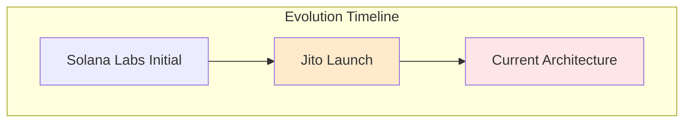
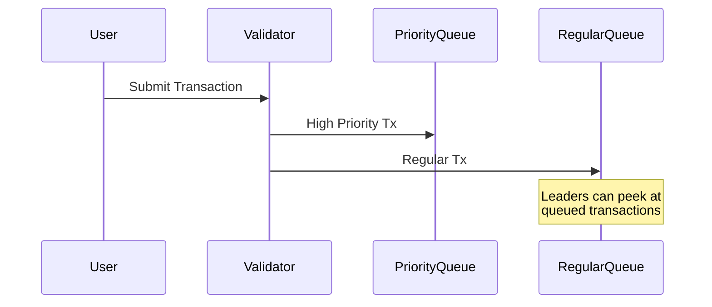
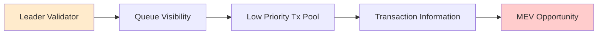

# Introduction

This document traces the evolution of Solana's MEV architecture, focusing on key developmental changes and their implications. The analysis covers historical patterns, infrastructure modifications, and architectural decisions that have shaped the current MEV ecosystem.

# Architectural Evolution Analysis: Solana MEV & Front-Running

## Historical Evolution

### Initial Design (Solana Labs)
- Standard Solana Labs validator implementation
- Leader schedule publicly known in advance
- Basic transaction ordering by arrival time
- No specialized MEV infrastructure

### Pre-March 2023 (Jito Launch)
- Jito introduces MempoolStream and bundle infrastructure
- Specialized MEV extraction capabilities
- Bundle submission endpoints established
- First systematic MEV capture system

### Post-March 2023
- Jito mempool discontinued
- Direct leader slot queue access
- Bundle processing through consensus mechanisms
- Current extraction patterns established

### Key Architectural Shifts
1. Solana Labs: Basic validator implementation
2. Jito Introduction: First specialized MEV infrastructure
3. Post-March: Direct leader slot architecture

## March Architecture Changes

### Shift to Local Mempools
- Moved from global to local mempool architecture
- Introduced priority/regular transaction queues
- Jito validators use MempoolStream for ordering

### Queue System

## Current Exploitation Vector

### Leader Validator Privileges

### Key Findings
1. Initial design allowed network-wide visibility
2. March changes concentrated visibility to leaders
3. Leaders can now peek at queued transactions
4. Priority fee system creates natural transaction delays
5. Jito's MempoolStream provides additional ordering control

## Evidence from Documentation

From Helius documentation:
> "Most validators use the scheduler implementation provided by Solana Labs. However, validators running the Jito validator client use a pseudo-mempool (i.e., MempoolStream) to order transactions."

From Jito documentation:
> "Bundles allow one to send a list of transactions that get executed sequentially, atomically, and all-or-nothing."

### Implementation Reality
- Multiple validator client implementations exist
- Direct leader slot queue access
- Bundle processing capabilities
- Transaction ordering control through consensus mechanisms

# Conclusion

The architectural evolution of Solana's MEV infrastructure reveals a consistent pattern of centralization and optimization for MEV extraction. Key findings demonstrate how architectural decisions have reinforced control points and shaped the current MEV landscape. Future developments will likely continue this trajectory unless significant architectural changes are implemented.
