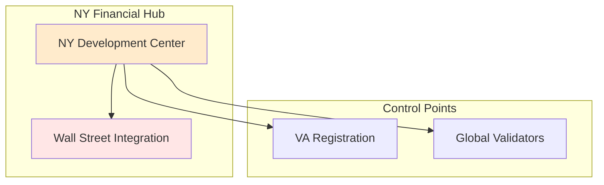
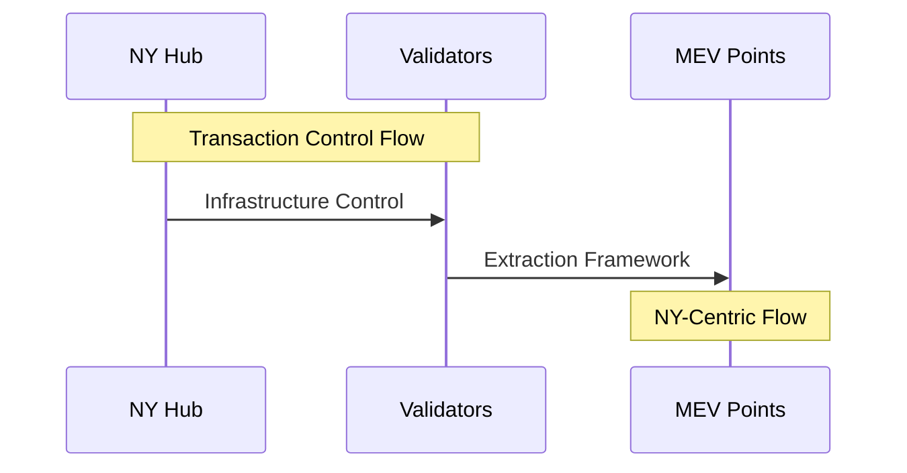

# Introduction

This analysis examines the jurisdictional implications of Solana's MEV infrastructure, with particular focus on development control and geographic distribution. Through OSINT analysis of 198 out of 350 contributors, we identify significant patterns in development concentration and control mechanisms.

# Jurisdictional Analysis: MEV Infrastructure & Regulatory Implications

## Geographic Distribution

This diagram shows the NY development center's connections to both Wall Street and key control points in the network.



## Development Statistics

1. **Verified Contribution Data** (198/350 contributors analyzed)
   - Total Contributions: 20,585
   - NY-Based Contributions: 9,702 (47.1%)
   - Other Contributions: 10,883 (52.9%)

2. **Employee Contributions**
   - Total Solana Employees: 32 (16.2% of analyzed contributors)
   - Employee Contributions: 8,106 (39.4% of total)
   - Top NY Contributors:
     * mvines: 3,973 contributions
     * brooksprumo: 847 contributions
     * sakridge: 777 contributions
     * CriesofCarrots: 678 contributions
     * rob-solana: 658 contributions

## Contributor Statistics

Visualization of the 198 analyzed contributors, showing the split between Solana employees and other NY-based developers.

```mermaid
# Caption: Contributor Distribution - Analysis of 198/350 contributors showing geographic concentration
graph TD
    subgraph "NY Development Hub"
        NY[NY Contributors: 52 total]
        S[Solana Employees: 32]
        NS[Non-Solana NY: 20]
        
        NY --> S
        NY --> NS
    end
    
    subgraph "Contribution Distribution"
        C1[NY: 47.1% of commits]
        C2[Other: 52.9% of commits]
        
        NY --> C1
        
        style NY fill:#ffebcc
        style C1 fill:#ffe6e6
    end
```

## Repository Analysis

1. **Sample Coverage**
   - Analyzed: 198 out of 350 total contributors
   - Focus: Most active contributors
   - Total Contributions Analyzed: 20,585

2. **Core Development** (From Analyzed Sample)
   - NY-based: 52 contributors (26.3%) [LinkedIn OSINT]
   - NY Contributions: 9,702 (47.1%)
   - Other Contributors: 146 (73.7%)
   - Other Contributions: 10,883 (52.9%)

3. **Solana Employee Distribution**
   - Total Solana Employees Found: 32 (16.2% of analyzed)
   - NY-based Solana: 32 (100%) [LinkedIn OSINT]
   - Non-NY Solana: 0
   - Solana Employee Contributions: 8,106 (39.4%)

4. **Top Contributors (All NY-Based)**
   - mvines: 3,973 contributions
   - brooksprumo: 847 contributions
   - sakridge: 777 contributions
   - CriesofCarrots: 678 contributions
   - rob-solana: 658 contributions

## Transaction Flow Analysis

Shows how NY-based infrastructure influences transaction flow and MEV extraction through the validator network.



## Key Considerations

1. **NY Dominance**
   - Primary development hub
   - Financial sector integration
   - MEV infrastructure control

2. **Infrastructure Reality**
   - NY-based transaction flow
   - Wall Street proximity advantage
   - Financial corridor leverage

3. **Development Control**
   - NY technical leadership
   - Core infrastructure decisions
   - Protocol evolution direction

## Infrastructure Impact

Demonstrates how NY hub's development control flows through to network architecture and control mechanisms.


## Jurisdictional Evidence

1. **Transaction Patterns**
   - NY-centric flow concentration
   - Financial district integration
   - Wall Street trading patterns

2. **Development Footprint**
   - NY technical leadership
   - Core protocol decisions
   - Infrastructure deployment control

3. **Network Distribution**
   - NY hub dominance
   - Global validator network
   - Centralized control patterns

## Documentation Analysis

1. **Infrastructure Control**
   - NY development concentration
   - Technical decision flow
   - Protocol evolution direction

2. **Transaction Evidence**
   - NY-based MEV patterns
   - Financial sector integration
   - Wall Street proximity effects

3. **Control Mechanisms**
   - NY hub authority
   - Development direction
   - Protocol governance influence 

# Conclusion

The jurisdictional analysis reveals a clear concentration of development control and infrastructure in New York, with 47.1% of analyzed contributions and 100% of identified Solana employees based in NY. This geographic centralization has significant implications for regulatory oversight and protocol governance. 