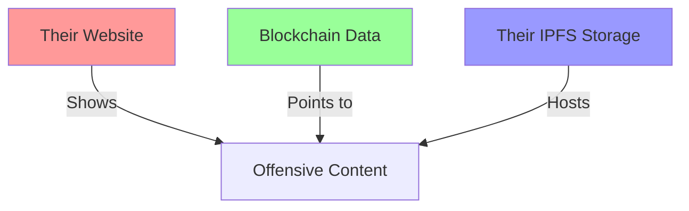

# Content Removal Guide: Three Layers of Control

## Overview

PumpDotFun controls offensive content at three distinct layers. They must remove content from ALL THREE layers to comply with the cease and desist.

## Layer 1: Their Website & Systems
- They run the website where content is uploaded
- They control the database where it's stored
- They manage the servers that display it
- **They can remove this immediately**

## Layer 2: Blockchain Records
- They control the program that manages token information
- They own the authority that can update token data
- They can change token information at any time
- **No technical barriers prevent them from updating this**

## Layer 3: IPFS Storage
- They run the service that keeps content available
- They control whether files stay accessible
- They can remove access immediately
- **Once unpinned, content becomes inaccessible**

## Why All Three Matter

Even if they remove content from their website:
1. Blockchain still points to content
2. IPFS still serves the content
3. Other sites can still display it

## Required Actions

1. **Website/Systems**
   - Remove from their displays
   - Delete from their databases
   - Stop serving through their APIs

2. **Blockchain Data**
   - Update token information
   - Remove references to content
   - Mark as legally removed

3. **IPFS Storage**
   - Stop storing the files
   - Remove from their servers
   - Make content inaccessible

## Why They Must Comply

1. They control their own website
2. They own the program that can update blockchain data
3. They run the IPFS storage service

There are NO technical barriers preventing immediate compliance with ALL THREE layers.

## Timeline for Compliance

All three layers can be updated within minutes:
- Website updates are immediate
- Blockchain updates take one transaction
- IPFS removal is instantaneous

## Verification Points

1. **Website Check**
   - Their site shows no content
   - Their APIs return no data
   - Their databases contain no content

2. **Blockchain Check**
   - Token data updated
   - No links to content
   - Marked as removed

3. **IPFS Check**
   - Content not accessible
   - Files not stored
   - Links broken

## Conclusion

They control ALL THREE layers where offensive content exists. Technical excuses for non-compliance are invalid - they have full control and ability to remove content immediately.