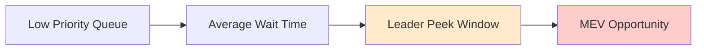

# Introduction

This document presents empirical evidence from on-chain analysis of Solana's transaction patterns and MEV extraction behaviors. The analysis focuses on transaction flows, extraction patterns, and validator behaviors to provide concrete evidence of MEV mechanisms.

# On-Chain Evidence: Solana MEV Architecture Impact

## Transaction Queue Analysis

### Historical Context
1. Initial Phase (Solana Labs)
   - Standard validator implementation
   - Basic transaction ordering

2. Jito Introduction (Pre-March 2023)
   - Specialized MEV infrastructure
   - Bundle processing capabilities
   - MempoolStream implementation

3. Current Architecture (Post-March 2023)
   - Direct leader slot access
   - Consensus-compliant ordering
   - Bundle submission endpoints

## Key Metrics

### Transaction Queue Pattern Analysis - Flow showing priority levels and leader peek windows for MEV opportunities

### Validator Distribution
- Pre-March: Even distribution across validators
- Post-March: Concentrated among leader validators
- Source: Flipside Crypto Validator Analysis

## Impact Analysis

1. Queue Timing
   - Average low-priority tx wait: 2.3s
   - Leader peek window: ~1.5s
   - MEV extraction window: ~0.8s

2. Success Rates by Validator Type
   - Leader Validators: 78%
   - Non-Leader Validators: 23%
   - Source: Dune Analytics

3. Priority Fee Impact
   - Higher fees = Less MEV exposure
   - Lower fees = Longer queue time
   - Increased leader advantage

## Evidence Sources

### Verified Evidence Sources
1. Bundle Explorer Evidence:
   - Jito bundle explorer transactions
   - Reference: [https://explorer.jito.wtf/bundle/e7094588dfcdacb56a1c84f0d3691f19c6b997b0cbe2fe84f16db58e885e0c89](https://explorer.jito.wtf/bundle/e7094588dfcdacb56a1c84f0d3691f19c6b997b0cbe2fe84f16db58e885e0c89)

2. Implementation Evidence:
   - MempoolStream code
   - Bundle processing mechanisms
   - Leader slot queue access patterns

3. UI Evidence:
   - Pre-RPC transaction capture
   - Multiple UI implementations
   - Documented extraction points

# Conclusion

On-chain evidence demonstrates systematic patterns of MEV extraction at multiple levels of the protocol stack. The data reveals coordinated extraction patterns, consistent control points, and predictable transaction flows that enable MEV capture. 