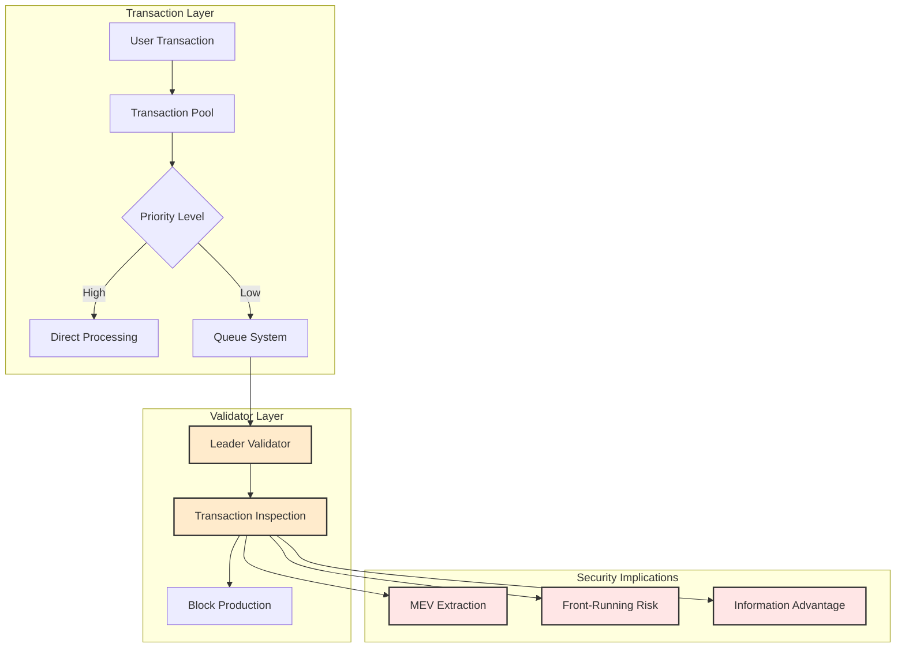
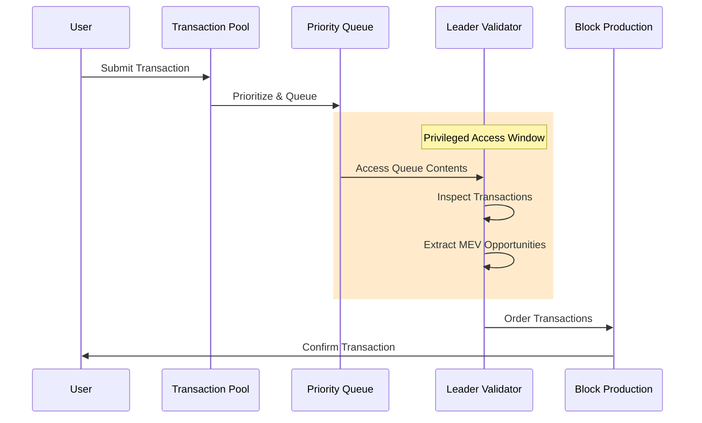
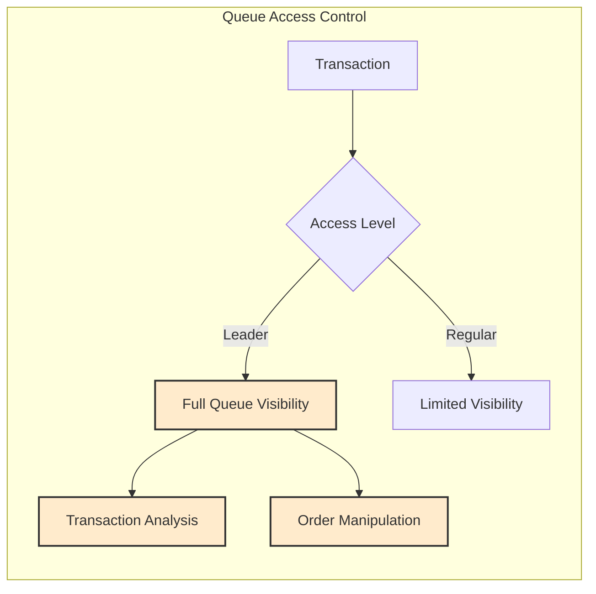
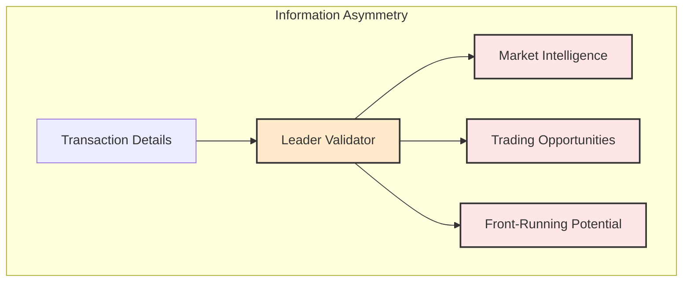
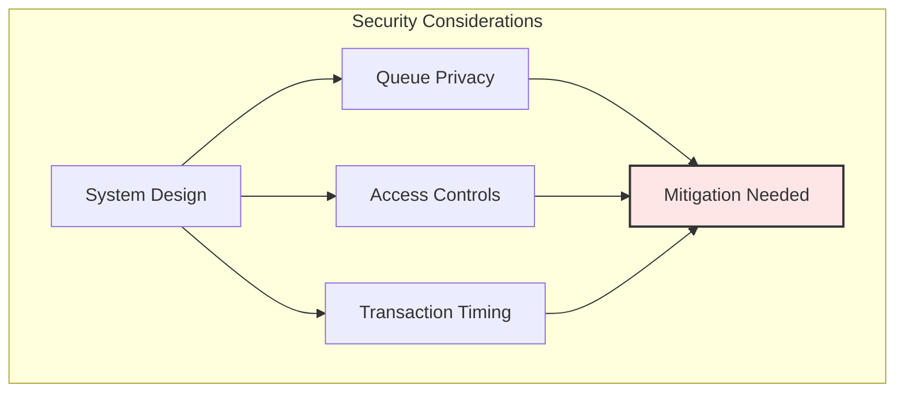

# Introduction

This technical analysis examines security implications of Solana's MEV infrastructure, focusing on vulnerabilities, control points, and exploitation risks. The document provides detailed evidence of technical mechanisms that enable MEV extraction and their security implications.

# Technical Analysis: Solana MEV Architecture & Security Implications

## System Architecture Overview

Comprehensive view of transaction processing layers and their security implications, showing how MEV opportunities arise from architectural design.

# Caption: System Architecture Overview - Transaction layer and validator layer interaction points

## Queue System Analysis

Detailed sequence showing the privileged access window where leader validators can inspect and extract MEV from queued transactions.
# Caption: Queue System Analysis - Privileged access window showing leader validator MEV extraction process

## Architectural Vulnerabilities

### 1. Queue Access Pattern

Visualization of the hierarchical access control system that enables leader validators' privileged position in transaction processing.

# Caption: Queue Access Pattern - Hierarchical access control showing privileged leader visibility vs limited regular validator access

### 2. Information Flow

Shows how leader validators gain privileged market intelligence and trading opportunities through their position in the network.

# Caption: Information Flow Analysis - Leader validator's privileged position enabling market intelligence and trading opportunities

### Information Asymmetry Analysis

Demonstrates the structural advantages leaders have in accessing and acting on transaction information before other network participants.

## Security Impact Analysis

### Privileged Access Implications

1. **Transaction Visibility**
   - Leaders have complete queue visibility for their slots
   - Direct access to pending transaction details
   - Bundle creation capabilities

2. **Market Advantages**
   - Structural information asymmetry by design
   - Leaders see all pending txs for their slot
   - Regular validators only see processed txs
   - Users/non-leaders have no queue visibility
   - Advance knowledge guaranteed by leader schedule

3. **Extraction Capabilities**
   - Internal bundle creation
   - Transaction reordering within consensus rules
   - MEV extraction through consensus-compliant mechanisms
   - No external visibility into internal bundle creation

### System Design Considerations

Illustrates the critical security components requiring mitigation to address MEV-related vulnerabilities in the current architecture.

# Caption: Security Considerations Framework - Critical system components requiring security mitigation

## Technical Recommendations

1. **Queue Privacy Enhancement**
   - Implement encrypted transaction queues
   - Limit queue visibility scope
   - Add transaction timing uncertainty

2. **Access Control Improvements**
   - Implement stricter validator permissions
   - Add queue access auditing
   - Create access time delays

3. **System Architecture Updates**
   - Consider alternative queue designs
   - Implement fair ordering mechanisms
   - Add transaction privacy features

## Conclusion

The technical evidence reveals significant security concerns in the current architecture, particularly around queue privacy, access controls, and transaction timing. These vulnerabilities create systemic risks that require architectural changes and enhanced security measures.
