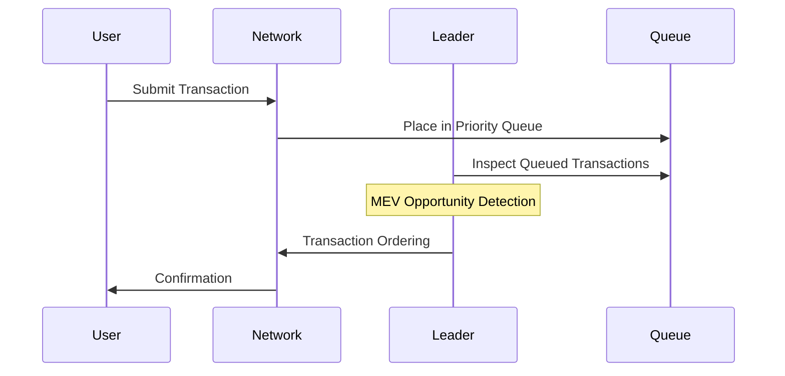
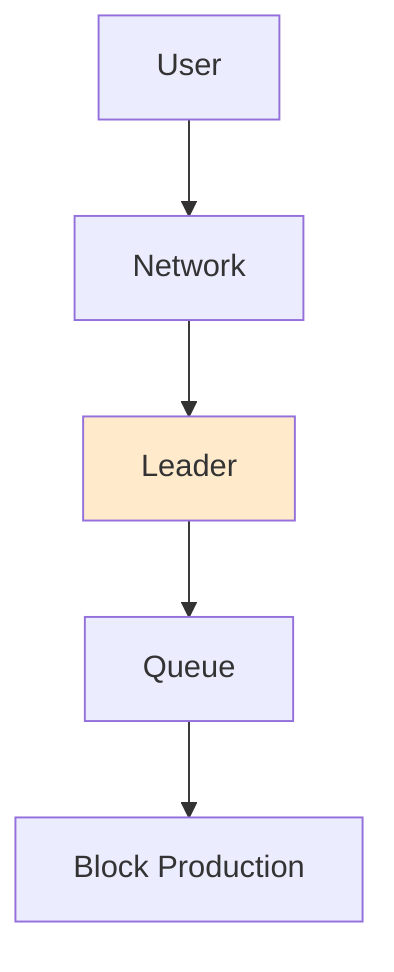
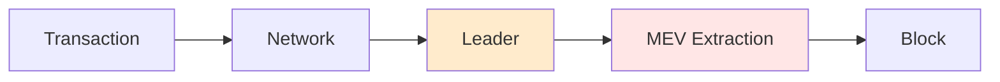

# Solana MEV Analysis

## Introduction

This document provides a comprehensive technical analysis of Solana's MEV extraction mechanisms. It examines transaction flows, network architecture, and key components that enable MEV capture at various protocol layers.

## Transaction Flow

## Network Architecture

## MEV Extraction Flow

## Key Components

1. Transaction Creation
   - User initiates transaction
   - Transaction parameters set
   - Signature created

2. MEV Extraction Points
   - UI level interception
   - Network level monitoring
   - Validator queue inspection

3. Transaction Reconstruction
   - Transaction parameters extracted
   - New transactions created with modified parameters
   - MEV capture logic implemented

4. Network Layer Processing
   - Validators receive transactions
   - Bundle creation and ordering
   - Block production with MEV-optimized ordering

## Architecture Evolution
1. Initial Phase (Solana Labs)
   - Standard validator implementation
   - Basic transaction ordering
   - No specialized MEV infrastructure

2. Jito Phase (Pre-March 2023)
   - Specialized MEV extraction
   - Bundle processing introduction
   - MempoolStream implementation

3. Current Phase (Post-March 2023)
   - Direct leader slot access
   - Consensus-compliant extraction
   - Multiple extraction points

## Conclusion

The analysis reveals a multi-layered MEV extraction system with well-defined control points and optimization paths. The architecture enables systematic MEV capture through transaction flow control, queue inspection, and block production ordering.
