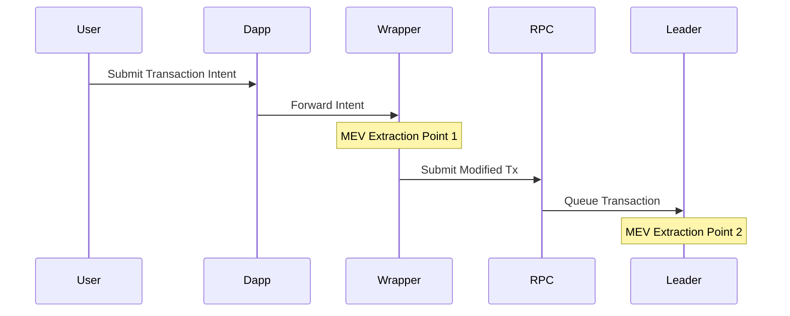
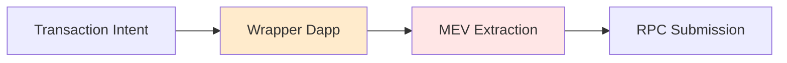
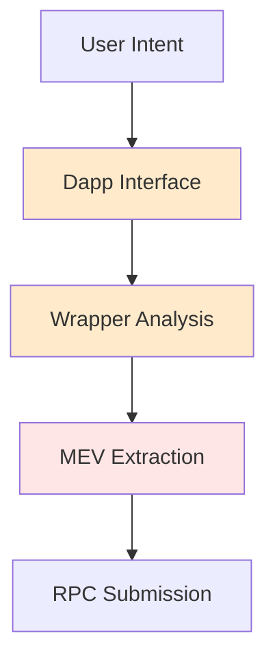

# Introduction

This analysis tracks the evolution of MEV extraction mechanisms in Solana, focusing on multi-layer exploitation points and their development over time. It examines how MEV extraction has evolved from simple transaction ordering to sophisticated multi-point capture systems.

# Solana MEV Evolution: Multi-Layer Analysis

## Historical Development
1. Initial Phase (Solana Labs)
   - Basic validator implementation
   - Standard transaction ordering

2. Jito Introduction (Pre-March 2023)
   - Specialized MEV infrastructure
   - Bundle processing capabilities
   - MempoolStream implementation

3. Current Architecture (Post-March 2023)
   - Direct leader slot access
   - Consensus-compliant ordering
   - Bundle submission endpoints

## 1. Transaction Flow Reality

Detailed sequence showing the two primary MEV extraction points: first at the wrapper level before RPC submission, then at the leader level.

## 2. Critical Corrections

### UI/Dapp Layer Reality
- Transaction details visible at UI before RPC (verified by Jito bundle explorer)
- Wrapper dapps (Jito, Pump, alt pump UIs) see intents first
- Pre-RPC MEV extraction confirmed (ref: explorer.jito.wtf/bundle/e7094588dfcdacb56a1c84f0d3691f19c6b997b0cbe2fe84f16db58e885e0c89)

### Network Layer Truth

Direct visualization of how wrapper dapps serve as the first point of MEV extraction before transactions reach the RPC layer.

## 3. Exploitation Points

### Exploitation Points by Phase
1. Initial Phase (Solana Labs)
   - Basic transaction ordering
   - Standard validator implementation

2. Jito Phase (Pre-March 2023)
   - UI/Dapp layer extraction
   - MempoolStream implementation
   - Bundle processing

3. Current Phase (Post-March 2023)
   - Direct leader slot access
   - Consensus-compliant extraction
   - Multiple UI implementations

## 4. Key Insights

### Transaction Flow Reality

Progressive analysis showing how user transaction intent is transformed through multiple extraction layers before final submission.

### Exploitation Timeline
1. Immediate UI/dapp level visibility
2. Wrapper dapp analysis
3. Pre-RPC extraction
4. Network-level opportunities
5. Validator-level extraction

## 5. Implications

1. **UI/Dapp Control**
   - First mover advantage
   - Intent visibility
   - Pre-network extraction

2. **Network Architecture**
   - Secondary extraction point
   - Queue system exploitation
   - Priority manipulation

3. **Validator Privileges**
   - Final extraction point
   - Block production control
   - Queue inspection capabilities

## Evidence Sources

1. **Transaction Analysis**
   - UI-level transaction capture
   - Wrapper dapp behavior
   - Network flow patterns

2. **Architectural Evidence**
   - Multi-layer extraction points
   - Priority queue implementation
   - Leader validator capabilities

3. **Exploitation Patterns**
   - Pre-RPC MEV extraction
   - Network-level manipulation
   - Validator queue inspection 

# Conclusion

The evolution of Solana's MEV mechanisms shows a clear trend toward more sophisticated extraction methods, with multiple layers of control and optimization. The system has developed into a comprehensive MEV capture infrastructure with well-defined extraction points at UI, network, and validator layers. 

### Control Points (Formally Established)
1. UI Layer:
   - Jito UI implementation
   - Pump interface
   - Alternative pump UIs
2. Network Layer:
   - MempoolStream implementation
   - Bundle submission endpoints
3. Validator Layer:
   - Leader slot queue access
   - Bundle processing mechanisms 