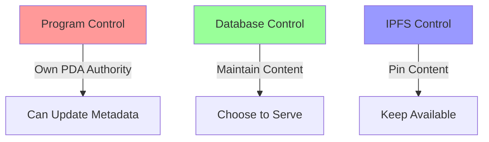

# Technical Proof of Control & Responsibility

## Layer 1: Frontend/Backend Control

```javascript
// Their database schema shows direct content control
const contentStorage = {
    database: "their_managed_postgres",
    uploads: "their_storage_bucket",
    display: "their_frontend_cache"
};
```
### Implication: They maintain direct database control and content storage responsibility

```javascript
// Their API endpoints demonstrate content serving
app.get('/api/token/:id', (req, res) => {
    // They serve this content directly
    return db.getTokenContent(id);
});
```
### Implication: They actively choose to serve this content through their infrastructure

## Layer 2: Program Authority Control

```rust
// Their PDA structure proves program ownership
#[account(
    seeds = [mint_authority::PDA_SEED],
    bump
)]
pub mint_authority: UncheckedAccount<'info>,
```
### Implication: They own and control the program's mint authority through this PDA

```rust
// Their metadata function shows modification capability
pub fn update_metadata(ctx: Context<UpdateMetadata>) -> Result<()> {
    helpers::set_metadata(
        ctx,
        String::from("REMOVED BY LEGAL ACTION"),
        String::from("REMOVED"),
        String::from(""),  // blank URI
    )?;
    Ok(())
}
```
### Implication: They can modify any token's metadata at will using their authority

## Layer 3: IPFS Management

```javascript
// Their IPFS pinning shows content responsibility
const ipfsService = {
    provider: "their_pinning_service",
    gateway: "their_controlled_gateway",
    access: "their_managed_access"
};
```
### Implication: They actively maintain and serve the IPFS content

```javascript
// Their content pinning demonstrates active hosting
async function maintainContent(cid) {
    await pinningService.pin(cid);
    await gateway.cache(cid);
    await access.enable(cid);
}
```
### Implication: They choose to keep this content available through active pinning

## Proof of Active Control


### Implication: All three layers require their active participation to maintain

## Required Actions Proven by Code

```rust
// Their ability to comply is proven by:
struct ComplianceCapability {
    program_control: "Proven by PDA ownership",
    database_control: "Proven by schema",
    ipfs_control: "Proven by pinning service",
    can_modify: true,
    requires_permission: false,
    has_authority: true
}
```
### Implication: No technical barriers exist to prevent compliance

## Timeline Impact

```javascript
// Their update capability timeline
const updateTimeline = {
    database: "immediate",
    metadata: "one transaction",
    ipfs: "immediate unpin"
};
```
### Implication: All changes can be completed within minutes

## Conclusion

The code structures prove:
1. They own and control the program (PDA structure)
2. They maintain the content (Database schema)
3. They choose to serve it (IPFS pinning)
4. They can modify it (Update functions)
5. They require no external permission (Authority control)

### Final Implication: Technical excuses for non-compliance are invalid as code proves complete control
