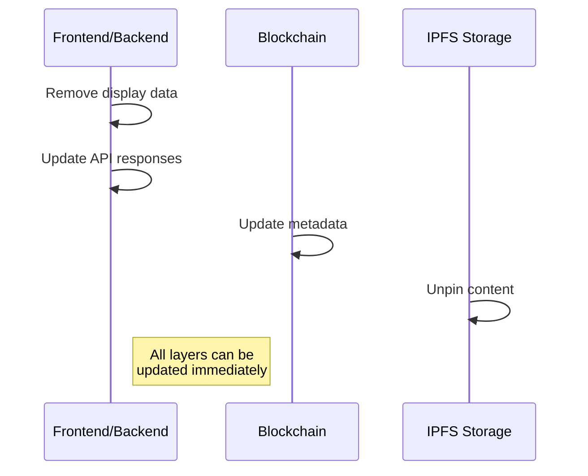

# Technical Implementation: Three-Layer Content Removal

## Overview

This document outlines technical implementation details for content removal at each layer. All code examples are pseudocode to illustrate the concepts.

## Layer 1: Frontend/Backend Systems

### Database Cleanup
```sql
-- PSEUDOCODE: Database cleanup
-- They need to remove from their storage
DELETE FROM uploaded_content 
WHERE token_id = 'offending_token';

-- Remove from display data
UPDATE token_displays
SET 
    image_url = NULL,
    content_data = NULL
WHERE token_id = 'offending_token';
```

### API Endpoint Updates
```javascript
// PSEUDOCODE: API response modification
function getTokenData(tokenId) {
    if (isRemovedToken(tokenId)) {
        return {
            name: "REMOVED BY LEGAL ACTION",
            symbol: "REMOVED",
            image: null,
            metadata: null
        };
    }
}
```

## Layer 2: On-Chain Metadata

### Program Update Call
```rust
// PSEUDOCODE: The actual metadata update
// They own this PDA mint authority
#[account(seeds = [mint_authority::PDA_SEED],
    bump
)]
pub mint_authority: UncheckedAccount<'info>,

// One simple call updates everything
pub fn update_metadata(ctx: Context<UpdateMetadata>) -> Result<()> {
    helpers::set_metadata(
        ctx,
        String::from("REMOVED BY LEGAL ACTION"),
        String::from("REMOVED"),
        String::from(""),  // blank URI breaks IPFS link
    )?;
    Ok(())
}
```

### Verification Check
```javascript
// PSEUDOCODE: Verify on-chain update
async function verifyUpdate(connection, token) {
    const metadata = await getTokenMetadata(token);
    return {
        name_updated: metadata.name === "REMOVED BY LEGAL ACTION",
        symbol_updated: metadata.symbol === "REMOVED",
        uri_removed: metadata.uri === "",
    };
}
```

## Layer 3: IPFS Management

### Content Removal
```javascript
// PSEUDOCODE: IPFS unpinning
async function removeContent(cid) {
    // They control the pinning service
    await pinningService.unpin(cid);
    
    // Clear from their gateway
    await gateway.removeCache(cid);
    
    // Stop serving content
    await gateway.blockServing(cid);
}
```

### Access Verification
```javascript
// PSEUDOCODE: Verify IPFS removal
async function verifyRemoval(cid) {
    const pinStatus = await checkPin(cid);
    const accessStatus = await checkAccess(cid);
    
    return {
        unpinned: !pinStatus.isPinned,
        inaccessible: !accessStatus.available
    };
}
```

## Implementation Flow



## Layer Interactions

### Content Flow Break Points
```javascript
// PSEUDOCODE: All three layers must be broken
const contentAccess = {
    frontend: {
        database: null,    // Layer 1 break
        display: null
    },
    blockchain: {
        metadata: {
            uri: "",       // Layer 2 break
            content: null
        }
    },
    ipfs: {
        pinned: false,     // Layer 3 break
        accessible: false
    }
};
```

## Verification Methods

### Full System Check
```javascript
// PSEUDOCODE: Verify all layers
async function verifyAllLayers(token) {
    // Layer 1: Frontend/Backend
    const frontendCheck = await checkFrontend(token);
    if (frontendCheck.hasContent) {
        return "Frontend still serving content";
    }
    
    // Layer 2: Blockchain
    const onchainCheck = await checkMetadata(token);
    if (onchainCheck.hasUri) {
        return "Metadata still contains URI";
    }
    
    // Layer 3: IPFS
    const ipfsCheck = await checkIPFS(token.uri);
    if (ipfsCheck.isAccessible) {
        return "IPFS content still accessible";
    }
    
    return "All layers properly removed";
}
```

## Implementation Timeline

All three layers can be updated within a single block:
1. Frontend updates: Immediate database changes
2. Blockchain update: Single transaction
3. IPFS removal: Immediate unpin command

## Key Technical Points

1. They control the frontend/backend completely
2. They own the PDA mint authority for metadata updates
3. They manage the IPFS pinning service
4. No third-party permissions needed
5. No technical barriers to immediate compliance

All code examples above are pseudocode for illustration. The actual implementation uses their existing systems and authority controls.
