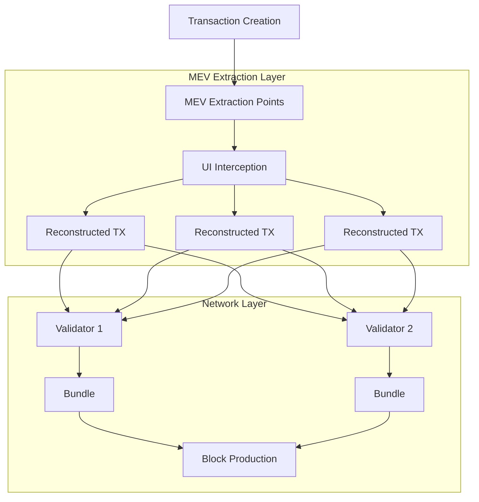

# Introduction

This document provides detailed visualizations and analysis of Solana's transaction flows, focusing on MEV extraction points and control mechanisms. The diagrams illustrate how transactions move through the system and where MEV extraction occurs.

# Solana Transaction Flow & MEV Extraction Points

This diagram shows how transactions are intercepted at the UI layer, reconstructed for MEV extraction, and processed through multiple validators before final block inclusion.

## Key Components

1. Transaction Creation
   - User initiates transaction
   - Transaction parameters set
   - Signature created

2. MEV Extraction Points
   - UI level interception
   - Network level monitoring
   - Validator queue inspection

3. Transaction Reconstruction
   - Transaction parameters extracted
   - New transactions created with modified parameters
   - MEV capture logic implemented

4. Network Layer Processing
   - Validators receive transactions
   - Bundle creation and ordering
   - Block production with MEV-optimized ordering

# Conclusion

The transaction flow analysis reveals multiple MEV extraction opportunities throughout the transaction lifecycle. The diagrams demonstrate how the current architecture enables systematic MEV capture through strategic positioning of control points and extraction mechanisms.
